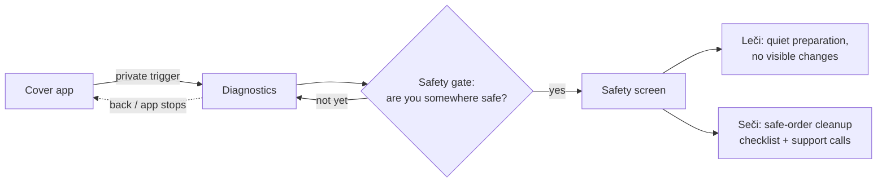

# Skadi

A survivor-centered Android anti-tracking tool for people facing tech-facilitated abuse: it helps find how an abuser may be monitoring a phone, then guides a safe response instead of a one-tap "delete". For developers, security researchers and advocates.

Built at the SheSafe Hackathon (Challenge 03, Tracking Check), Belgrade, June 2026.


> [!IMPORTANT]
> **If you think your phone or accounts are being monitored, read this from a device the other person cannot access** (a trusted friend's phone, a library computer). Suddenly removing an app or changing passwords can alert the person tracking you. Talk to an advocate first:
> - US: [National Domestic Violence Hotline](https://www.thehotline.org/), 1-800-799-7233
> - Worldwide: [Coalition Against Stalkerware](https://stopstalkerware.org/) (resources and help by country)
> - Serbia: ASTRA SOS 011/785-0000 · Autonomous Women's Center 0800 100 007 · Police 192
>
> In immediate danger, call your local emergency number.

## What it does

- **Hides in plain sight.** Skadi runs inside a fully working everyday app; the safety layer opens only through a private trigger, so someone with physical access to the phone sees an ordinary app.
- **Treats tracking as more than malware.** The threat model covers abused legitimate access (shared accounts, location sharing, family-management tools, Bluetooth trackers) as well as stalkerware apps.
- **Safety gate first.** Before any action, the user is asked whether they are in a safe place.
- **Two modes for two situations.**
  - **Leči (Heal):** harm reduction while still in the relationship. Nothing visible changes; prepares a private in-memory snapshot (location coarsening is planned, currently a placeholder).
  - **Seči (Cut):** for the exit moment. A safe-order checklist: document first, then secure accounts from a device the abuser does not control, revoke sessions, remove suspicious apps, align timing with a support service. Includes tap-to-dial for ASTRA and the police.
- **Keeps nothing on disk.** Findings live only in memory; secret screens use `FLAG_SECURE` and reset when the app leaves the foreground.

## How it works



The single entry point for the hidden layer is `AppViewModel.onCustomDurationEntered()`. Pressing back or leaving the app returns to the cover screen. The cover app stores only its own ordinary data (Room + DataStore); scan results, evidence and any "secret mode" state are never written to disk.

## Quickstart

Requirements: Android Studio (Koala or newer) with JDK 17, and an Android 8.0+ phone with USB debugging. A real phone is recommended over an emulator because the scanner reads installed apps and permissions.

The Gradle wrapper scripts and JAR are **not committed**. Either open the folder in Android Studio (it syncs with Gradle 8.9), or generate the wrapper once with a local Gradle install:

```bash
git clone https://github.com/0jz/Skadi.git
cd Skadi
gradle wrapper --gradle-version 8.9
./gradlew assembleDebug
adb install -r app/build/outputs/apk/debug/app-debug.apk
```

On Windows use `gradlew.bat` instead of `./gradlew`. Build troubleshooting is in [BUILD_AND_DEBUG.md](BUILD_AND_DEBUG.md).

## Configuration

No environment variables, API keys or backend. All configuration is in Gradle:

| Setting | Value | Where |
|---|---|---|
| `minSdk` / `targetSdk` / `compileSdk` | 26 / 35 / 35 | `app/build.gradle.kts` |
| JVM target | 17 | `app/build.gradle.kts` |
| AGP / Kotlin / Compose BOM / Room | 8.5.2 / 2.0.21 / 2024.10.01 / 2.6.1 | `gradle/libs.versions.toml` |

## Usage

| Task | Command |
|---|---|
| Debug build | `./gradlew assembleDebug` |
| Install on phone | `adb install -r app/build/outputs/apk/debug/app-debug.apk` |
| Android lint | `./gradlew lint` |

There are no automated tests yet. [BUILD_AND_DEBUG.md](BUILD_AND_DEBUG.md) has log filters and a manual functional checklist.

## Documentation

| Doc | What |
|---|---|
| [SKADI.md](SKADI.md) | Original concept, threat model, scanner categories, safe-order plan (Serbian) |
| [PROGRESS.md](PROGRESS.md) | Progress log and current state (Serbian) |
| [BUILD_AND_DEBUG.md](BUILD_AND_DEBUG.md) | Opening, building and debugging on a real phone |
| [docs/MENTOR_TECHNICAL_BRIEF.md](docs/MENTOR_TECHNICAL_BRIEF.md) | Technical brief: Leči/Seči in implementation terms, data handling |
| [docs/REAL_SCANNER_EXECUTION_PLAN.md](docs/REAL_SCANNER_EXECUTION_PLAN.md) | Plan for the real on-device scanner |
| [docs/FEATURE_BRANCH_ROADMAP.md](docs/FEATURE_BRANCH_ROADMAP.md) | Feature branches, order and merge rules |
| [docs/PITCH_DECK.md](docs/PITCH_DECK.md) | Pitch deck outline |

## Project structure

```
Skadi/
├── app/src/main/java/<package>/
│   ├── MainActivity.kt          # Single activity; screen switching, FLAG_SECURE, reset on stop
│   ├── AppViewModel.kt          # App state; hidden-layer entry point
│   ├── data/                    # Room (cover-app data only) + DataStore settings
│   ├── diagnostics/             # Hidden diagnostics screen
│   ├── safety/                  # Safety gate and Leči/Seči screens
│   ├── scan/                    # In-memory scan result model (ScanSnapshot)
│   ├── (other folders)          # Cover app UI
│   └── ui/theme/                # Compose theme
├── gradle/libs.versions.toml    # Dependency versions
├── docs/                        # Technical brief, scanner plan, roadmap, pitch
└── SKADI.md, PROGRESS.md, BUILD_AND_DEBUG.md
```

## Status & limitations

- **Hackathon prototype, not ready for real-world use.** Do not rely on it for anyone's safety.
- The cover app, hidden entry, safety gate and Leči/Seči flow work. **The real scanner is not implemented yet**; `ScanSnapshot` starts empty. See the scanner plan above.
- Android only; no root, no backend. The app **never reads passwords** and does not use accessibility or overlays to watch other apps.
- A disguise is not invisibility: the package is still listed under system app settings.
- Any cleanup action (removing apps, changing passwords) can be noticed by the abuser. The app guides timing; it cannot make those actions invisible.
- Most project notes are in Serbian.

## License

No license file yet. All rights reserved by the author until one is added.
